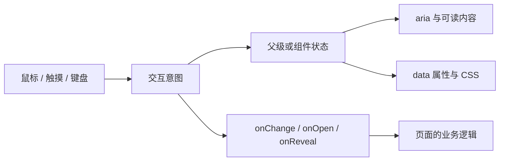

# 从效果到可复用代码

## 先分清四层



**状态**说明选中了谁、是否揭晓；**事件**表达用户的意图；**CSS**显示当前状态；**业务回调**决定是否保存或打开内容。拆开以后，同一组件可以放在课程、相册或赛事页，不需要了解 Supabase、路由或管理员。

高频指针坐标放在 ref 或 CSS 变量中，避免整棵 React 子树随鼠标重渲染。会改变可读内容的选择/揭晓则放在 state 中。焦点与屏幕阅读器信息必须随状态一起变化。

## 最小接入

从组件文件直接导入会同时加载组件样式。下面是非受控模式，组件自己管理选择；`cards` 是符合 AtlasCard 的数据：

```tsx
import { ShaderTabs } from './recipes/interaction-atlas/ShaderTabs'
import type { AtlasCard } from './recipes/interaction-atlas/types'

const cards: AtlasCard[] = [
  { id: 'map-a', title: '作品 A', image: '/your-map-a.webp', alt: '作品 A 的完整地图', author: '实际作者' },
  { id: 'map-b', title: '作品 B', image: '/your-map-b.webp', alt: '作品 B 的完整地图', author: '实际作者' },
]
export function Collection() {
  return <ShaderTabs items={cards} onChange={id => console.log('选择意图', id)} />
}
```

这里的图片路径是接入占位，须换成你自己的可访问图片。可以先使用示例中的 `cards` 运行。已有网站继续从 `components/lab/AtlasInteractions` 导入也能工作。

多个区域需要同步筛选时，用一个父级状态：

```tsx
const [selected, setSelected] = useState(cards[0]?.id ?? '')
<ShaderTabs items={cards} value={selected} onChange={setSelected} />
<ImageFlow items={cards} value={selected} onChange={setSelected} />
```

传入 value 后，onChange 只是请求：父级不更新 value，选择就不改变。不要在挂载期间反复切换受控与非受控模式。列表为空时显示空态/空容器；当前 id 被删除时视觉回退首项，但不会偷偷回调修改父级数据。父级要持久化回退结果，应在自己的数据更新逻辑中处理。

## 接口索引

| 接口 | 必需项 | 可选项与行为 |
| --- | --- | --- |
| AtlasCard | id、title、image、alt | author、description、color；id 在列表内唯一 |
| ShaderTabs | items | value、onChange(id)、label、panelContent |
| SilkPoster | item | eyebrow、onOpen()、motionReduced() |
| ExpandingStrip | items | value、onChange(id)、label |
| ScratchCard | item | threshold 默认 .45，限制 .1–.9，非有限值回退 .45；onReveal() |
| ReactionBar | items: Reaction[] | value: string/null、onChange(id/null)；undefined 为非受控 |
| Reaction | id、label、symbol | color |
| ImageFlow | items | value、onChange(id)、label、onOpen(id)、openLabel |

ShaderTabs 的 panelContent 可以是可编辑正文，不必是图片。提供它时，items 中的 image/alt 仍满足类型，但不渲染图片；赛事页因此传空字符串。普通图片模式必须提供有效路径和有意义的替代文本。

ScratchCard 换作品时传 `key={item.id}`，让 React 重建画布和揭晓状态。每次揭晓周期只发一次 onReveal；“重新覆盖”开始新的周期。

## 迁移到别的 React 项目

1. 复制 `src/recipes/interaction-atlas` 整个目录。只接入组件可省略 examples；保留组件、共享 TS/TSX 和 styles.css。无需复制网站的 lib、config 或 components/lab。
2. 使用支持 TSX 与 CSS 导入的 React 18/TypeScript 构建环境。本库未依赖 GSAP、Tailwind、Supabase、Next.js 或特定路由；此处未声称已在这些外部框架中逐一验收。
3. 由容器提供字体、背景和颜色；容器内使用 `box-sizing: border-box`。如果应用已有 reset，检查 button 默认边距/边框是否影响布局。
4. CSS 通过 `--atlas-tint` 着色，类名以 atlas 开头。多个品牌共用时可修改默认配色；不要把调用方的全局选择器写进组件。
5. 减少动态同时支持系统媒体查询和 `html[data-motion="reduced"]`。可给 SilkPoster 注入 motionReduced，但还必须同步 CSS 的 data-motion，避免 JS 和 CSS 偏好不一致。
6. 沿用完整图片比例。原图动作由 onOpen 交给自己的阅读器；不要把查看按钮嵌套进另一颗 button。

程序生成的示意图在 examples/data.ts 内，移植时不会引用天图府作品库或远程服务。源码没有自动持久化；需要存储时在业务层处理请求、失败和授权。

## 两个实际接入案例

**社团文化页：** [CultureView.tsx](../../src/views/CultureView.tsx) 将公开目录转成 AtlasCard，ImageFlow 发出 onOpen(id)，页面找到对应作品并交给原来的 Lightbox。缩略图和高清图仍由作品目录/阅读器区分。

**赛事页：** [ContestView.tsx](../../src/views/ContestView.tsx) 的 ShaderTabs 与作品、获奖名单使用同一筛选状态。先记录原数组索引，再筛选展示，EditableText 仍使用原索引，避免把“筛选后的第 0 条”写回原数组的第 0 条。

## 视觉与性能的真实取舍

- ShaderTabs 是 CSS 渐变纹理，不是真实 GPU shader；SilkPoster 是渐变叠层与倾斜，不是丝绸物理模拟。
- 海报用 transform，刮卡揭晓用 opacity；卡带/轮播使用 flex 布局动画，意图是重分配可读空间，会触发布局，适合少量项目。大量作品应先分页或窗口化，不能以这份小样例推断千张图片性能。
- 刮卡只在手势结束时统计透明面积，底图独立于画布，避免每次移动扫描整幅图。它是视觉交互，不是保密机制：图片已经在浏览器中。
- “减少动态”取消动画和倾斜，但选择、反应、揭晓和打开仍能工作。动画不能成为获取信息的唯一途径。

## 如何验证自己的改动

先跑 model 的纯函数测试，再用学习页操作受控锁定、清空/删项、重新覆盖和重置。组件的真实鼠标/触摸/键盘测试位于 [lab.browser.mjs](../../tests/lab.browser.mjs)；网站接入回归位于 [internal-interactions.browser.mjs](../../tests/internal-interactions.browser.mjs)；课程和独立页面回归位于 [interaction-learning.browser.mjs](../../tests/interaction-learning.browser.mjs)。

测试不会证明所有浏览器的表现、屏幕阅读器体验或生产云端权限。更改画布、触摸或布局后，除自动化外仍应在目标设备上实际操作。
